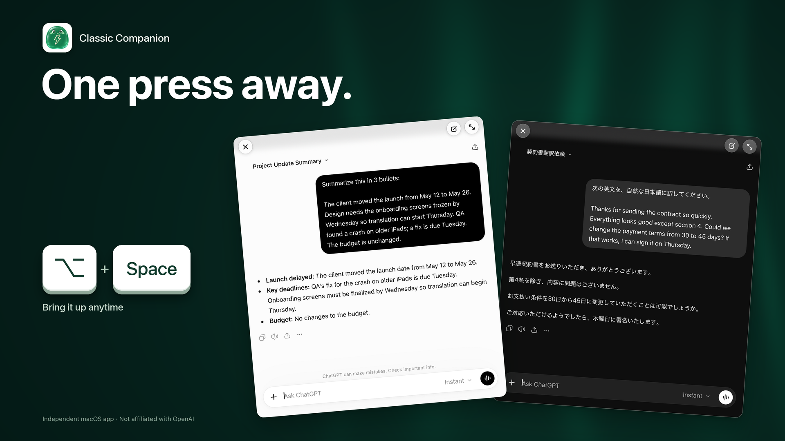

# Classic Companion

[English](README.md) · [日本語](README.ja.md) · [简体中文](README.zh-CN.md) · [繁體中文](README.zh-TW.md)


**ChatGPT, a shortcut away in a native macOS window.**

Classic Companion wraps the official ChatGPT website with SwiftUI, AppKit and WKWebView. Press `⌥ Space` to open a compact chat window, or switch to the full window with `⌃⌘F`. It includes configurable shortcuts, persistent sign-in, page zoom and four interface languages. ChatGPT provides the conversations and Read Aloud; this is an independent app, not affiliated with OpenAI.

This is the **public source repository**, licensed under [Apache-2.0](LICENSE). This repository brings together source code, downloads and feedback.

**[Download 0.1.0-beta.2 (DMG) →](https://github.com/xtymac/ClassicCompanion/releases/download/v0.1.0-beta.2/ClassicCompanion-0.1.0-beta.2-20261113.1719-arm64.dmg)** · [Release notes](https://github.com/xtymac/ClassicCompanion/releases/tag/v0.1.0-beta.2) · [Feedback](https://github.com/xtymac/ClassicCompanion/issues)

Latest beta: 0.1.0-beta.2 (build 20261113.1719), a pre-release for Apple silicon Macs with macOS 15 or later. If you have 0.1.0-beta.1, install this version once by hand; later versions can be installed from within the app.

## Review and verification

See the [review guide](docs/review.md) for validation results, architecture and remaining limitations. Since 0.1.0-beta.2 (build 20261113.1719), published builds include offline first-load recovery, in-app updates (Sparkle 2, nothing is downloaded before you confirm; see [updates.md](docs/updates.md)), the lightning-bolt menu bar icon and a fix for New Chat clearing a just-typed draft; 0.1.0-beta.1 (build 20261110.0137) has none of these.

## Build and test

Use an Apple silicon Mac with macOS 15+ and full Xcode with Swift 6 support. The verified toolchain for this review is Xcode 27.2 / Swift 6.4.2 / macOS 27.2; other toolchains and the minimum OS have not been verified.

```sh
git clone https://github.com/xtymac/ClassicCompanion.git
cd ClassicCompanion
xcodebuild -version
swift --version
swift test
CC_SIGNING_MODE=adhoc scripts/build-app.sh debug
open "build/$(cat build/LATEST)/Classic Companion.app"
```

Run `swift test` in a logged-in macOS desktop session: some tests instantiate AppKit windows and real WKWebViews with synthetic pages, and the window suites briefly show windows, so don't type while the suite runs. Tests do not require a ChatGPT login, but manual testing of the official website needs internet access and a ChatGPT account.

The debug build uses ad-hoc signing and needs no maintainer signing certificate or notarization credentials. It is for local review, not distribution. Quit any installed copy first: the build uses the same bundle identifier, settings and WebKit sign-in storage. Use a separate macOS user if you need isolated data. Build output goes to a new `build/<timestamp>/` directory; two builds within the same minute are rejected.

## Code map

| Path | Purpose |
| --- | --- |
| `Sources/ClassicCompanion/` | App lifecycle, windows, shortcuts, WKWebView, DOM adapter, localization and diagnostics |
| `Sources/CompanionCore/` | Navigation policy, URL redaction, zoom and recovery logic |
| `Tests/` | Core logic, localization, native UI and synthetic web-page tests |
| `scripts/` | Local builds, release packaging, notarization, verification and in-app update tooling |
| `assets/` | App icons resources |

## Known limitations

The official site's DOM can change and break optional web enhancements. Offline first-load recovery ships from 0.1.0-beta.2, but the system offline signal (Wi-Fi actually off) and a real login-time launch remain unverified. Image previews, interactive components, Read Aloud transitions, long-chat scrolling and some window/IME behavior still need review. macOS 15/26, Intel, fresh accounts and single-display full-screen behavior are not covered by the recorded acceptance checks; Intel is unsupported. See the complete [beta notes](docs/trial-notes.en.md) and the review guide.


## Contributing and licensing

Read [CONTRIBUTING.md](CONTRIBUTING.md), [BRANDING.md](BRANDING.md), and the [release setup](docs/release-signing.md). Code, documentation and app/menu icons use Apache-2.0; promotional images in `assets/marketing/` are excluded (see BRANDING.md). No trademark rights are granted.
