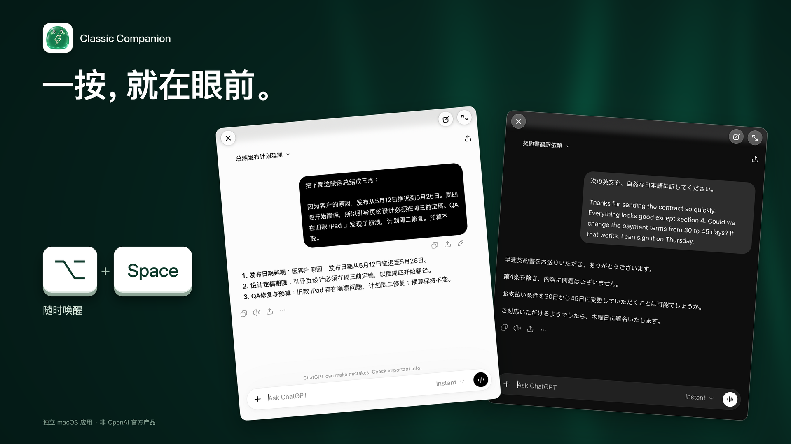

# Classic Companion

[English](README.md) · [日本語](README.ja.md) · [简体中文](README.zh-CN.md) · [繁體中文](README.zh-TW.md)


**按下快捷键，就能在原生 macOS 窗口中使用 ChatGPT。**

项目使用 SwiftUI、AppKit 和 WKWebView 承载 ChatGPT 官方网页。默认 `⌥ Space` 唤出小窗，`⌃⌘F` 切换完整窗口，提供可配置快捷键、持久登录、页面缩放及中简、中繁、英、日四种界面语言。对话和朗读由官方网页提供；本项目是独立应用，与 OpenAI 无隶属关系。

这是采用 [Apache-2.0](LICENSE) 的**公开源码仓库**。源码、下载和用户反馈统一在本仓库。

**[下载 0.1.0-beta.2（DMG）→](https://github.com/xtymac/ClassicCompanion/releases/download/v0.1.0-beta.2/ClassicCompanion-0.1.0-beta.2-20261113.1719-arm64.dmg)** · [版本说明](https://github.com/xtymac/ClassicCompanion/releases/tag/v0.1.0-beta.2) · [反馈](https://github.com/xtymac/ClassicCompanion/issues)

最新试用版：0.1.0-beta.2（构建 20261113.1719），预发布版，适用于 macOS 15 或更新版本的 Apple 芯片 Mac。已安装 0.1.0-beta.1 的用户需要手动安装一次本版，之后的版本可以在应用内更新。

## 审查与验证

架构、验证结果和未验证事项见[审查指南](docs/review.md)。从 0.1.0-beta.2（构建 20261113.1719）起，发布版包含首次离线加载恢复、应用内更新（Sparkle 2，确认之前不会下载，见 [updates.md](docs/updates.md)）、闪电菜单栏图标，以及新建对话后刚输入的内容被清掉的修复；0.1.0-beta.1（20261110.0137）都不包含。

## 构建与测试

需要 Apple silicon Mac、macOS 15+，以及支持 Swift 6 的完整 Xcode。本次验证环境为 Xcode 27.2 / Swift 6.4.2 / macOS 27.2，其他工具链和最低系统版本尚未验证。

```sh
git clone https://github.com/xtymac/ClassicCompanion.git
cd ClassicCompanion
xcodebuild -version
swift --version
swift test
CC_SIGNING_MODE=adhoc scripts/build-app.sh debug
open "build/$(cat build/LATEST)/Classic Companion.app"
```

在已登录的 macOS 桌面会话运行 `swift test`；部分测试会创建 AppKit 窗口及加载合成页面的真实 WKWebView，窗口测试会短暂弹出窗口，运行期间请勿输入。自动测试不需要登录 ChatGPT；官方网页的手动验收需要网络及 ChatGPT 账号。

debug 使用 ad-hoc 签名，不需要维护者的发布证书或公证凭据，仅供本地审查。运行前先退出已安装版本：本地构建沿用相同 Bundle ID，会共用设置和 WebKit 登录数据；需要隔离时使用独立 macOS 用户。每次输出到新的 `build/<时间戳>/`，同一分钟重复构建会被拒绝。

## 源码结构

| 路径 | 内容 |
| --- | --- |
| `Sources/ClassicCompanion/` | 应用生命周期、窗口、快捷键、WKWebView、DOM 适配、语言和诊断 |
| `Sources/CompanionCore/` | 导航策略、URL 脱敏、缩放和加载恢复逻辑 |
| `Tests/` | 核心逻辑、语言、原生 UI 与合成网页测试 |
| `scripts/` | 本地构建、发布打包、公证、验证和应用内更新工具 |
| `assets/` | 应用图标与设计资源 |

## 已知限制

官网 DOM 变化可能影响网页增强；首次离线加载后的恢复从 0.1.0-beta.2 起包含在发布版中，但系统断网信号（真正关闭 Wi-Fi）和开机登录时的真实启动仍未验证。图片预览、交互组件、朗读切换、长对话滚动及部分窗口和输入法行为仍需验证。现有验收未覆盖 macOS 15/26、全新用户和单屏全屏场景；不支持 Intel。完整问题见[试用版说明](docs/trial-notes.md)及 review 指南。


## 贡献与授权

请阅读[贡献说明](CONTRIBUTING.md)、[品牌说明](BRANDING.md)及[发布配置](docs/release-signing.md)。代码、文档及应用／菜单栏图标采用 Apache-2.0；`assets/marketing/` 中的宣传图片不在此授权范围内，详见 BRANDING.md。不授予商标权。
